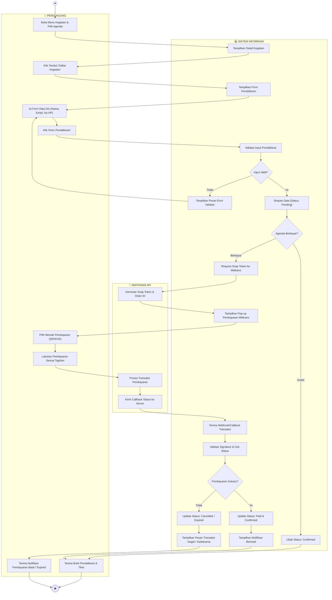
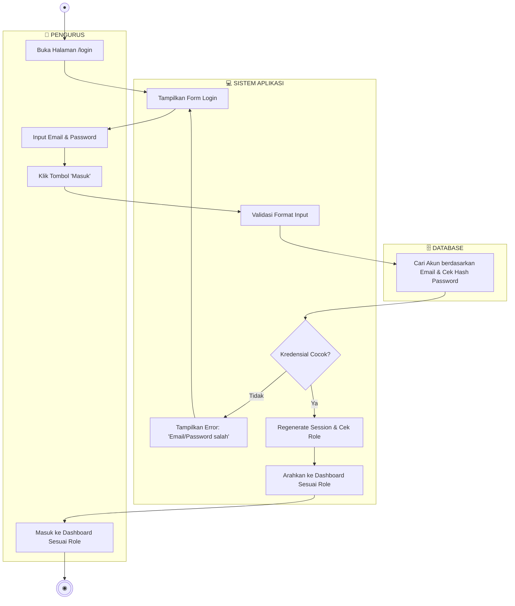
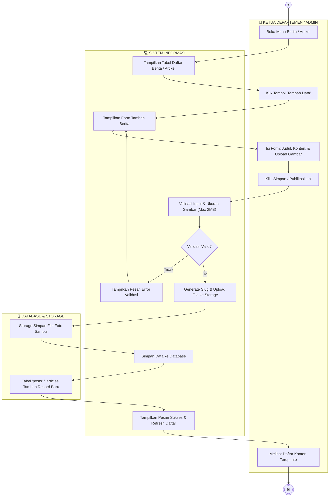
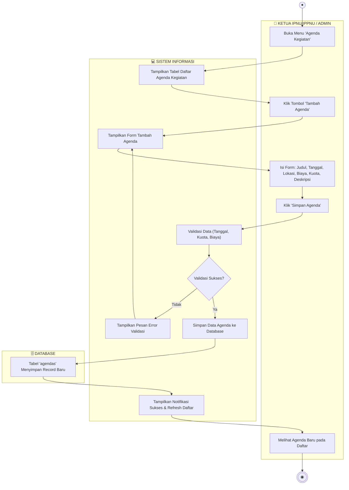
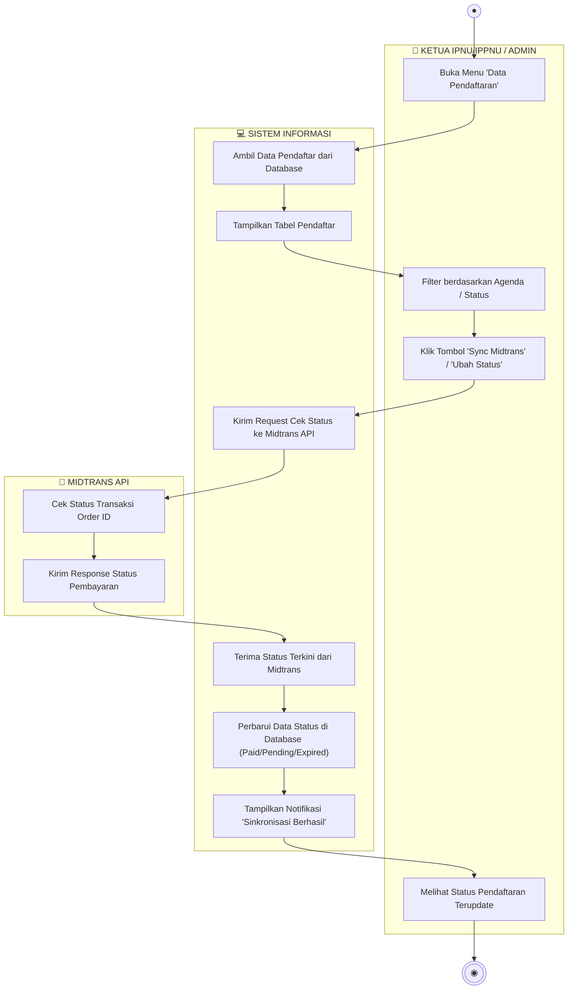
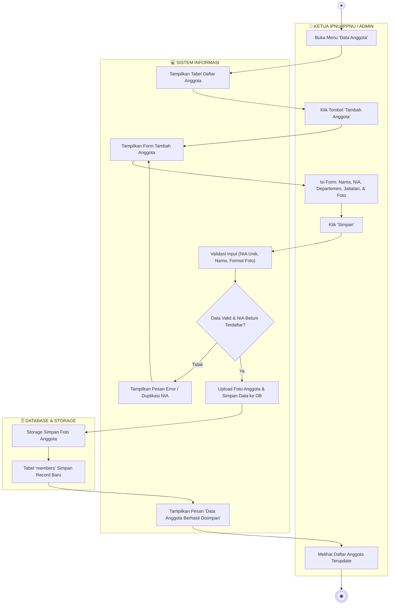
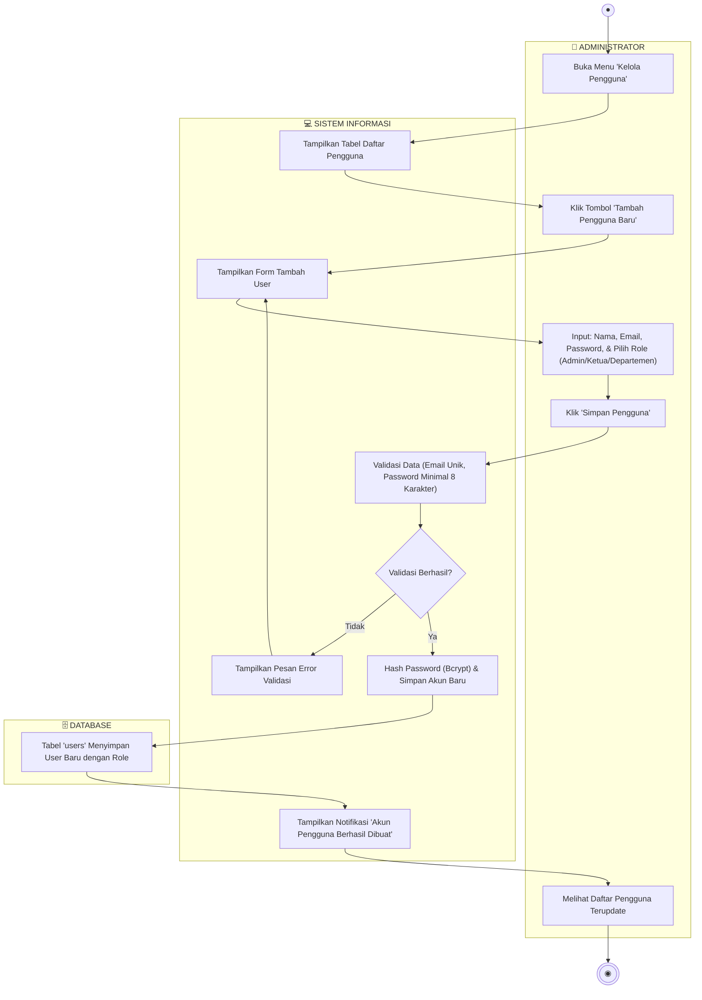

# Dokumentasi Lengkap Activity Diagram — Sistem Informasi PK IPNU-IPPNU

Dokumen ini memuat **7 Activity Diagram lengkap** yang merepresentasikan seluruh proses bisnis dan Use Case utama dalam aplikasi, lengkap dengan pembagian jalur tanggung jawab (**Swimlane / Partition**).

> 💡 **Catatan Metodologi & Notasi UML**:
> - **Pendekatan Swimlane**: Mengadopsi arsitektur 3-Tier (*User Presentation*, *Application Logic / Sistem*, dan *Data Storage / Third-Party Gateway*).
> - **Penanganan Validasi**: Setiap proses *input* dilengkapi *Decision Node* untuk menangani kondisi validasi gagal (*alternative path*) maupun validasi sukses (*happy path*).
> - **File Mentahan draw.io**: File [**`activity_diagram.drawio`**](file:///e:/zallzall/pk-ipnu-ippnu/activity_diagram.drawio) dapat dibuka dan diekspor melalui **[app.diagrams.net](https://app.diagrams.net/)**.

---

## 1. Pendaftaran & Pembayaran Kegiatan (Publik & Midtrans)
Alur pengunjung saat mendaftar kegiatan, menangani agenda gratis vs berbayar, integrasi Snap Midtrans, serta penanganan sukses maupun pembatalan/expired.

---

## 2. Login & Autentikasi Pengurus (Semua Role)
Alur verifikasi login pengguna (Admin, Ketua, Ketua Departemen) dengan hashing kata sandi dan pengecekan otorisasi peran.

---

## 3. Pengelolaan Berita & Artikel (Ketua Departemen & Admin)
Alur melihat daftar konten, menambah berita baru, validasi ukuran file gambar, hingga publikasi ke sistem.

---

## 4. Pengelolaan Agenda Kegiatan (Ketua IPNU/IPPNU & Admin)
Alur pembuatan dan pembaruan agenda kegiatan organisasi beserta kuota dan tarif pendaftaran.

---

## 5. Pengelolaan Data Pendaftar & Sinkronisasi Midtrans (Ketua & Admin)
Alur memantau pendaftar kegiatan, cek status pembayaran, sinkronisasi *real-time* ke Midtrans API, dan pembaharuan status lokal.

---

## 6. Pengelolaan Data Anggota / Members (Ketua & Admin)
Alur pendataan keanggotaan IPNU/IPPNU (biodata, jabatan, departemen, validasi NIA unik, dan upload foto).

---

## 7. Pengelolaan Data Pengguna / User Management (Administrator Only)
Alur administrator membuat akun pengurus baru lengkap dengan *role assignment* dan enkripsi kata sandi.

