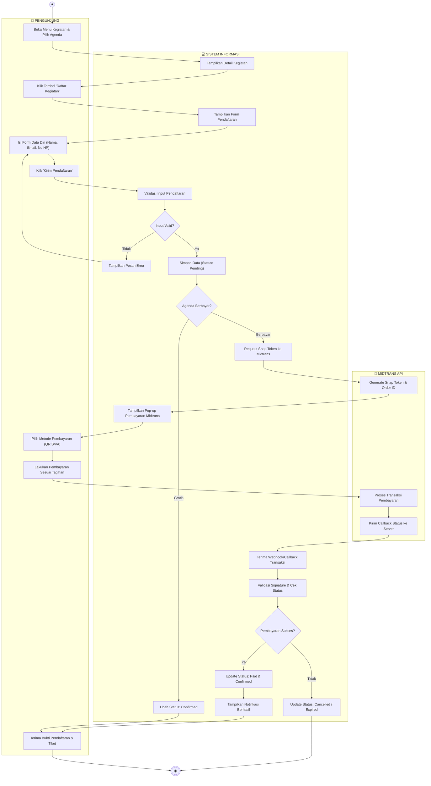
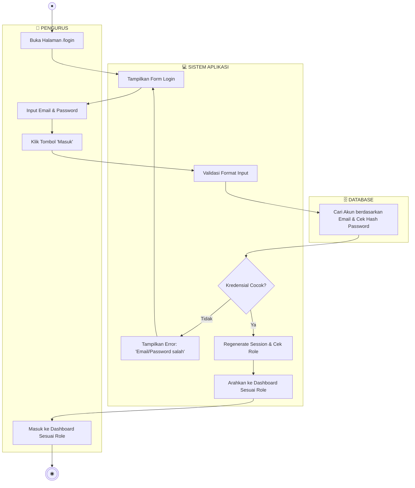
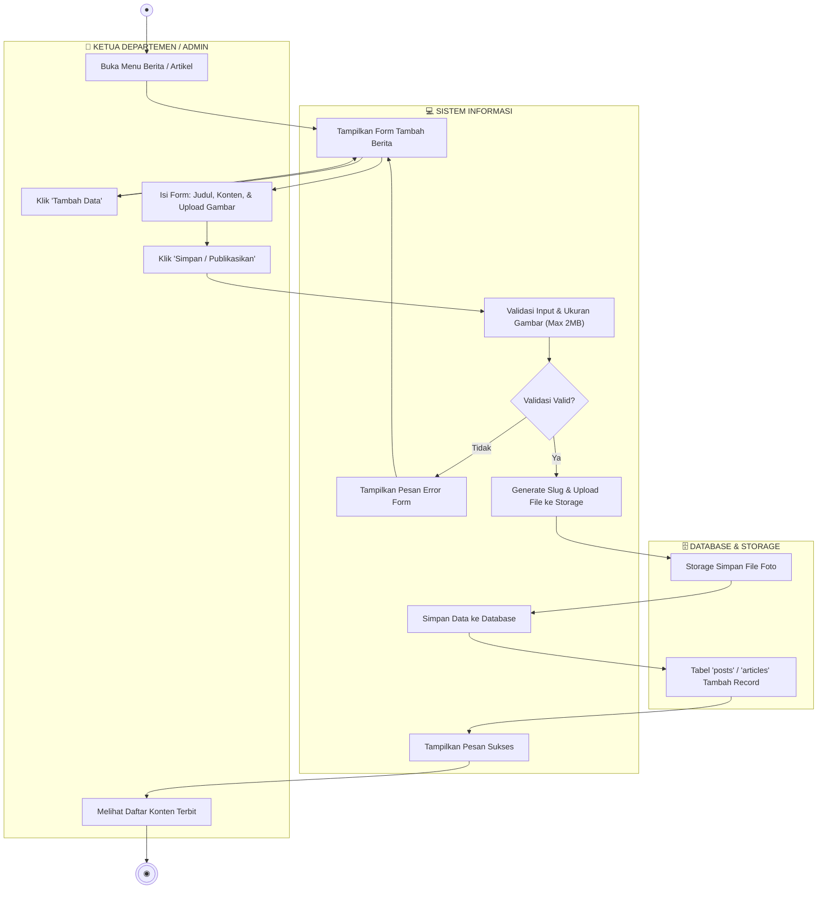
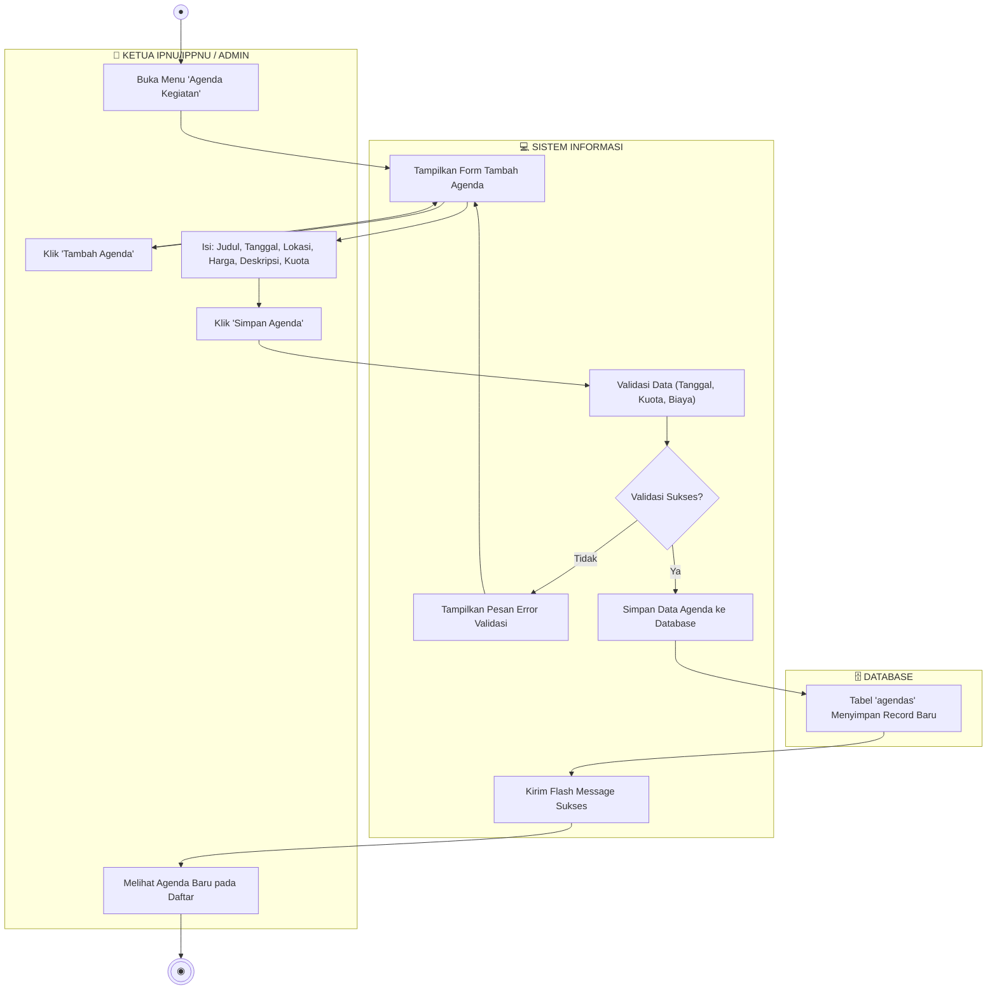
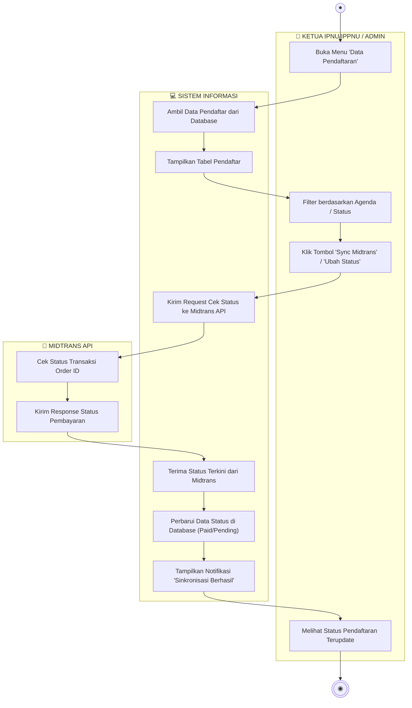
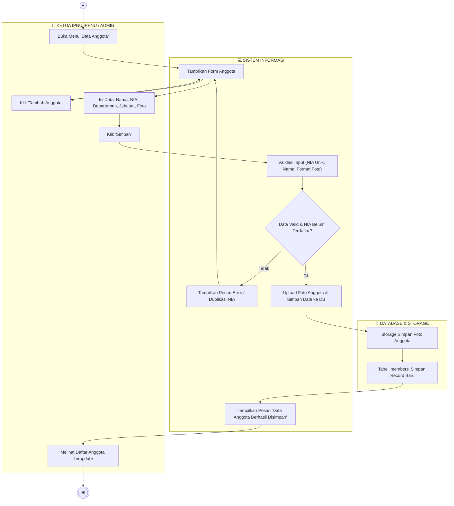
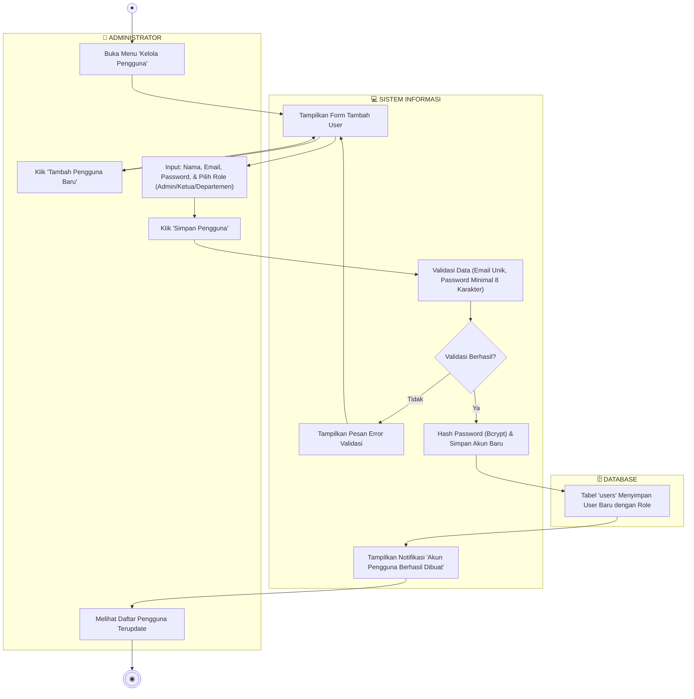

# Dokumentasi Lengkap Activity Diagram — Sistem Informasi PK IPNU-IPPNU

Dokumen ini memuat **7 Activity Diagram lengkap** yang merepresentasikan seluruh proses bisnis dan Use Case utama dalam aplikasi, lengkap dengan pembagian jalur tanggung jawab (**Swimlane / Partition**).

---

## 1. Pendaftaran & Pembayaran Kegiatan (Publik & Midtrans)
Alur pengunjung saat mendaftar kegiatan, menangani agenda gratis vs berbayar, hingga konfirmasi pembayaran.

---

## 2. Login & Autentikasi Pengurus (Semua Role)
Alur verifikasi login pengguna (Admin, Ketua, Ketua Departemen).

---

## 3. Pengelolaan Berita & Artikel (Ketua Departemen & Admin)
Alur CRUD penerbitan artikel/berita organisasi dan pengelolaan gambar sampul.

---

## 4. Pengelolaan Agenda Kegiatan (Ketua IPNU/IPPNU & Admin)
Alur pembuatan dan pembaruan agenda kegiatan organisasi.

---

## 5. Pengelolaan Data Pendaftar & Sinkronisasi Midtrans (Ketua & Admin)
Alur memantau pendaftar kegiatan, cek status bayar, sinkronisasi ulang ke Midtrans, dan update status.

---

## 6. Pengelolaan Data Anggota / Members (Ketua & Admin)
Alur pendataan keanggotaan IPNU/IPPNU (biodata, jabatan, departemen, dan foto).

---

## 7. Pengelolaan Data Pengguna / User Management (Administrator Only)
Alur admin membuatkan akun pengurus (karena registrasi publik dinonaktifkan).

