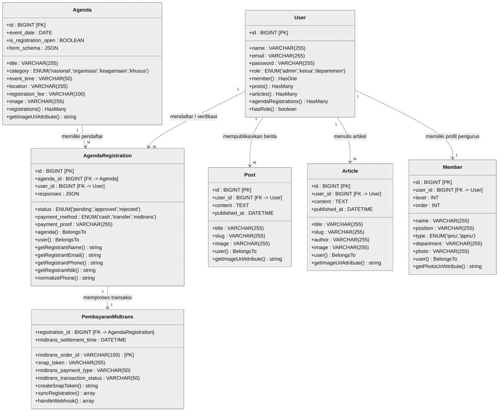

# 4.7. Class Diagram

Class Diagram menggambarkan struktur statis dari kelas-kelas (*models* & *services*) pembentuk **Sistem Informasi PK IPNU-IPPNU**, lengkap dengan atribut, tipe data, *Primary Key* (`[PK]`), *Foreign Key* (`[FK]`), metode/operasi bisnis, serta kardinalitas relasi antar-kelas (`1` ke `1` maupun `1` ke `M`).

> 💡 **File Siap Ekspor di draw.io**:
> File mentahan [**`class_diagram.drawio`**](file:///e:/zallzall/pk-ipnu-ippnu/class_diagram.drawio) sudah disusun **100% mengikuti format referensi laporan Anda** (Hitam-Putih, 3 kompartemen: Nama Kelas, Atribut rata dua kolom dengan `[PK]`/`[FK → Kelas]`, dan Method rata dua kolom beserta garis relasi siku `1` ke `M` / `1` ke `1`). Tersedia dalam 2 Tab:
> 1. **Tab 1 (`1. Class Diagram Utama (Sesuai Contoh)`)**: 7 Kelas Inti berelasi (`Agenda`, `AgendaRegistration`, `PembayaranMidtrans`, `Member`, `User`, `Post`, `Article`) tanpa garis saling silang, pas 1 halaman laporan.
> 2. **Tab 2 (`2. Class Diagram Lengkap (Semua Model)`)**: Seluruh 11 Model (`Agenda`, `AgendaRegistration`, `Member`, `User`, `Post`, `Article`, `Gallery`, `Quote`, `Statistic`, `SiteSetting`, `PageSetting`) + 2 Service (`MidtransService`, `NotificationService`) sesuai struktur kode PHP aplikasi.

---

## 4.7.1. Visualisasi Class Diagram Inti (Mermaid)

<strong>Gambar 4.22 Class Diagram Sistem Informasi PK IPNU-IPPNU</strong>

---

## 4.7.2. Daftar Spesifikasi Kelas & Relasi

| No | Nama Kelas (Model / Service) | Tabel Database | Relasi Utama | Deskripsi Fungsi |
| :-: | :--- | :--- | :--- | :--- |
| 1 | [`User`](file:///e:/zallzall/pk-ipnu-ippnu/app/Models/User.php) | `users` | `1..M` ke `Post`, `Article`, `AgendaRegistration`; `1..1` ke `Member` | Menyimpan akun pengguna (`admin`, `ketua`, `departemen`) dan otentikasi. |
| 2 | [`Agenda`](file:///e:/zallzall/pk-ipnu-ippnu/app/Models/Agenda.php) | `agendas` | `1..M` ke `AgendaRegistration` | Menyimpan jadwal kegiatan, tarif pendaftaran, dan skema form dinamis (`form_schema`). |
| 3 | [`AgendaRegistration`](file:///e:/zallzall/pk-ipnu-ippnu/app/Models/AgendaRegistration.php) | `agenda_registrations` | `M..1` ke `Agenda` & `User`; `1..1` ke `MidtransService` | Menyimpan data pendaftar kegiatan (`responses` JSON), metode bayar (`cash`, `transfer`, `midtrans`), dan status verifikasi. |
| 4 | [`MidtransService`](file:///e:/zallzall/pk-ipnu-ippnu/app/Services/MidtransService.php) | `agenda_registrations` *(kolom Midtrans)* | `1..1` dengan `AgendaRegistration` | Mengelola pembuatan *Snap Token*, pengecekan status transaksi API, dan *Webhook Callback* Midtrans. |
| 5 | [`Post`](file:///e:/zallzall/pk-ipnu-ippnu/app/Models/Post.php) | `posts` | `M..1` ke `User` | Menyimpan berita kegiatan resmi organisasi beserta foto sampul. |
| 6 | [`Article`](file:///e:/zallzall/pk-ipnu-ippnu/app/Models/Article.php) | `articles` | `M..1` ke `User` | Menyimpan artikel opini/tulisan kader beserta nama penulis dan slug. |
| 7 | [`Member`](file:///e:/zallzall/pk-ipnu-ippnu/app/Models/Member.php) | `members` | `1..1` ke `User` | Menyimpan struktur kepengurusan dan direktori anggota IPNU & IPPNU. |
| 8 | [`Gallery`](file:///e:/zallzall/pk-ipnu-ippnu/app/Models/Gallery.php) | `galleries` | Mandiri *(Managed by User)* | Menyimpan dokumentasi foto galeri kegiatan organisasi. |
| 9 | [`Quote`](file:///e:/zallzall/pk-ipnu-ippnu/app/Models/Quote.php) | `quotes` | Mandiri *(Managed by User)* | Menyimpan kutipan motivasi/ulama yang tampil di halaman beranda. |
| 10 | [`Statistic`](file:///e:/zallzall/pk-ipnu-ippnu/app/Models/Statistic.php) | `statistics` | Mandiri *(Managed by User)* | Menyimpan data statistik capaian dan jumlah kader aktif (`scopeActive`, `scopeOrdered`). |
| 11 | [`SiteSetting`](file:///e:/zallzall/pk-ipnu-ippnu/app/Models/SiteSetting.php) | `site_settings` | Mandiri *(Managed by Admin)* | Menyimpan identitas situs, logo, favicon, sosial media, dan gambar hero default. |
| 12 | [`PageSetting`](file:///e:/zallzall/pk-ipnu-ippnu/app/Models/PageSetting.php) | `page_settings` | Mandiri *(Managed by Admin)* | Menyimpan konfigurasi halaman statis (sejarah, visi-misi, kustomisasi header & fitur). |
| 13 | [`NotificationService`](file:///e:/zallzall/pk-ipnu-ippnu/app/Services/NotificationService.php) | *(Service Layer)* | Menggunakan `User`, `AgendaRegistration`, `Article` | Mengambil daftar notifikasi penting untuk dasbor Admin, Ketua, dan Departemen. |
