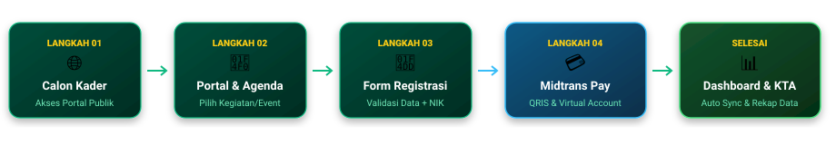

<!-- ======================================================== -->
<!-- HEADER BANNER ANIMASI SVG LOKAL (RESILIENT & OFFLINE)    -->
<!-- ======================================================== -->
<p align="center">
  
</p>

<!-- ======================================================== -->
<!-- ANIMATED TYPING SVG SUB-HEADER                          -->
<!-- ======================================================== -->
<p align="center">
  <a href="https://git.io/typing-svg">
    
  </a>
</p>

<!-- ======================================================== -->
<!-- BADGES                                                   -->
<!-- ======================================================== -->
<p align="center">
  
  
  
  
  
  
  
</p>

<!-- ======================================================== -->
<!-- TECH STACK ICONS                                         -->
<!-- ======================================================== -->
<p align="center">
  <a href="https://skillicons.dev">
    
  </a>
</p>

---

## 📌 Ringkasan Platform

> **"Mewujudkan digitalisasi organisasi pelajar santri yang adaptif, terintegrasi, dan profesional."**

**Sistem Informasi PKPT IPNU IPPNU UNSIQ** adalah ekosistem aplikasi web modern yang dibangun untuk menunjang kebutuhan:
* 🌐 **Media Publikasi Resmi:** Warta berita, artikel/opini ilmiah kader, galeri multimedia, dan agenda kegiatan komisariat.
* 💳 **Kaderisasi & Event Terpadu:** Sistem pendaftaran kegiatan (Makesta, Pelatihan, Seminar) dengan integrasi otomatis **Payment Gateway Midtrans** (QRIS, e-Wallet, Virtual Account).
* 👥 **Database Kader & Organisasi:** Pencatatan keanggotaan terpusat, rekapitulasi data pendaftar, dan statistik komisariat.
* 🛡️ **Multi-Role Back Office:** Otorisasi bertingkat untuk Super Admin, Ketua IPNU & IPPNU, dan Ketua Departemen.

---

## 🔄 Alur Kerja Sistem (System Workflow)

<p align="center">
  
</p>

| No | Tahapan | Deskripsi Interaksi |
| :---: | :--- | :--- |
| **01** | 🌐 **Calon Kader / Mahasiswa** | Mengakses portal publik untuk melihat informasi profil, agenda, dan warta terbaru. |
| **02** | 📰 **Portal & Agenda** | Memilih agenda kegiatan yang sedang dibuka pendaftarannya. |
| **03** | 📝 **Form Registrasi** | Mengisi formulir online yang dilengkapi auto-validation format NIK. |
| **04** | 💳 **Midtrans Payment** | Menyelesaikan transaksi via QRIS (GoPay, ShopeePay, Dana, dll.) atau Virtual Account Bank. |
| **05** | 📊 **Dashboard & Tiket** | Webhook Midtrans mengonfirmasi pembayaran seketika, tiket diterbitkan, dan data tersimpan di panel panitia. |

---

## 🌟 Fitur & Modul Utama

<details open>
<summary><b>🌐 1. Portal Publik (Front Office)</b></summary>
<br>

* 🏛️ **Profil Organisasi:** Visi, Misi, Kilas Sejarah, serta Bagan Struktur Kepengurusan dinamis.
* 📰 **Warta & Artikel:** Portal penerbitan berita seputar komisariat, opini pemikiran kader, dan artikel keislaman.
* 🖼️ **Galeri Kegiatan:** Dokumentasi foto dan dokumentasi kegiatan komisariat berkualitas tinggi.
* 📅 **Agenda Kegiatan:** Kalender jadwal event dengan countdown, detail pamflet, dan kuota pendaftar.
* 💬 **Quotes Mutiara:** Kutipan inspiratif para kiai, ulama, dan tokoh pergerakan NU.

</details>

<details open>
<summary><b>💳 2. Pendaftaran Online & Payment Gateway Midtrans</b></summary>
<br>

* 📝 **Validasi Identitas Cerdas:** Pengecekan keabsahan format NIK dan kontak WhatsApp secara otomatis.
* ⚡ **Metode Pembayaran Lengkap:** QRIS instan, e-Wallet, dan Virtual Account berbagai bank nasional.
* 🔄 **Sinkronisasi Otomatis (Webhook Callback):** Status pembayaran langsung lunas seketika tanpa perlu kirim bukti transfer manual ke admin.
* 🎫 **Unduh Bukti Registrasi:** Peserta memperoleh kode unik invoice dan ringkasan pendaftaran.

</details>

<details>
<summary><b>🛡️ 3. Panel Manajemen Multi-Role (Back Office)</b></summary>
<br>

Sistem membagi tugas kepengurusan menjadi 3 hak akses terpisah:

| Peran (Role) | Lencana | Tanggung Jawab & Hak Akses |
| :--- | :---: | :--- |
| **Super Admin** | 👑 | Manajemen User & Akun, Pengaturan Halaman Dinamis (*Page Settings*), Konfigurasi Website (*Site Settings*). |
| **Ketua IPNU & IPPNU** | 🔰 | Manajemen Agenda, Verifikasi & Sinkronisasi Massal Midtrans, Database Anggota/Kader (*Members*), Statistik, dan Kurasi Galeri. |
| **Ketua Departemen** | ✍️ | Pengelolaan Publikasi Berita (*Posts*), Artikel/Opini Kader (*Articles*), dan Kutipan Inspiratif (*Quotes*). |

</details>

---

## 💻 Panduan Instalasi di Komputer Lokal

<details>
<summary><b>📋 Prasyarat Sistem</b></summary>
<br>

* **PHP:** Versi `>= 8.2`
* **Composer:** Versi `>= 2.x`
* **Node.js:** Versi `>= 18.x`
* **Database & Server:** MySQL (Direkomendasikan via **Laragon**)

</details>

<details open>
<summary><b>⚡ Langkah-Langkah Menjalankan Project</b></summary>
<br>

**1. Kloning Repository:**
```bash
git clone https://github.com/username/pk-ipnu-ippnu.git
cd pk-ipnu-ippnu
```

**2. Instalasi Dependensi Backend & Frontend:**
```bash
# Dependensi PHP
composer install

# Dependensi JavaScript
npm install
```

**3. Setup Environment File (`.env`):**
```bash
cp .env.example .env
php artisan key:generate
```

**4. Sesuaikan Konfigurasi Database & Midtrans:**
```env
APP_NAME="PKPT IPNU IPPNU UNSIQ"
APP_URL=http://pk-ipnu-ippnu.test

DB_CONNECTION=mysql
DB_HOST=127.0.0.1
DB_PORT=3306
DB_DATABASE=pk_ipnu_ippnu
DB_USERNAME=root
DB_PASSWORD=

# Kredensial Midtrans
MIDTRANS_SERVER_KEY=SB-Mid-server-xxxxxxxxx
MIDTRANS_CLIENT_KEY=SB-Mid-client-xxxxxxxxx
MIDTRANS_IS_PRODUCTION=false
```

**5. Migrasi Database & Storage Symlink:**
```bash
php artisan migrate --seed
php artisan storage:link
```

**6. Jalankan Server Aplikasi:**

*Mode Simultan (Otomatis):*
```bash
composer run dev
```

*Atau Mode Terpisah:*
```bash
# Terminal 1: Server Laravel
php artisan serve

# Terminal 2: Vite Compiler
npm run dev
```

Akses web di peramban: `http://127.0.0.1:8000` atau `http://pk-ipnu-ippnu.test`.

</details>

---

## 📂 Struktur Direktori Utama

```plaintext
pk-ipnu-ippnu/
├── app/
│   ├── Http/Controllers/        # Controller Publik, Admin & Auth
│   ├── Middleware/             # Role authorization (admin, ketua, departemen)
│   └── Models/                 # Agenda, Registration, Member, Post, etc.
├── database/
│   ├── migrations/             # Skema tabel database
│   └── seeders/                # Data default & akun admin
├── public/
│   ├── banner.svg              # Asset Header Banner Animasi
│   ├── workflow.svg            # Asset Diagram Alur Sistem
│   └── footer.svg              # Asset Footer Banner
├── resources/
│   ├── js/
│   │   ├── Components/         # Komponen React (Navbar, Footer, Card, Modal)
│   │   ├── Layouts/            # AppLayout, AdminLayout, GuestLayout
│   │   └── Pages/              # View halaman React (Inertia Pages)
│   └── css/                    # Desain kustom Tailwind CSS
├── routes/
│   ├── web.php                 # Routing publik & panel admin
│   └── auth.php                # Routing autentikasi login
└── vite.config.js              # Konfigurasi bundler Vite + React
```

---

<!-- ======================================================== -->
<!-- FOOTER BANNER ANIMASI SVG LOKAL                          -->
<!-- ======================================================== -->
<p align="center">
  
</p>
