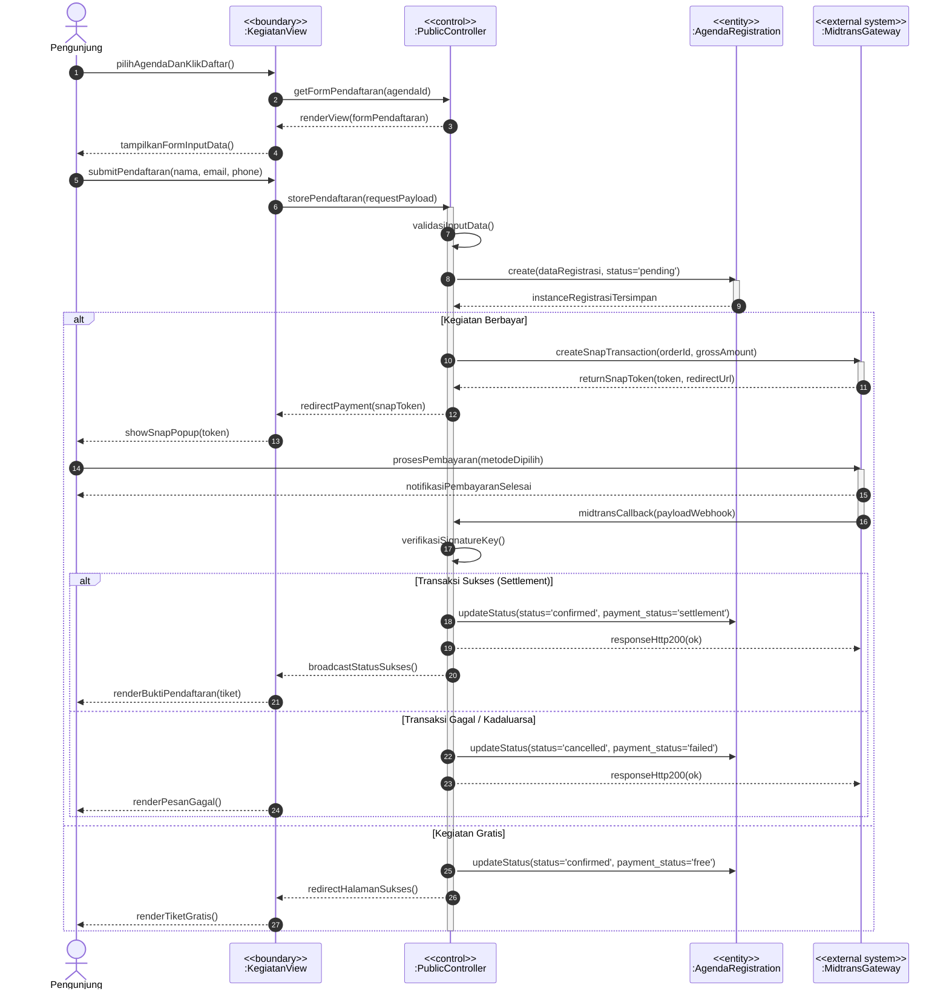
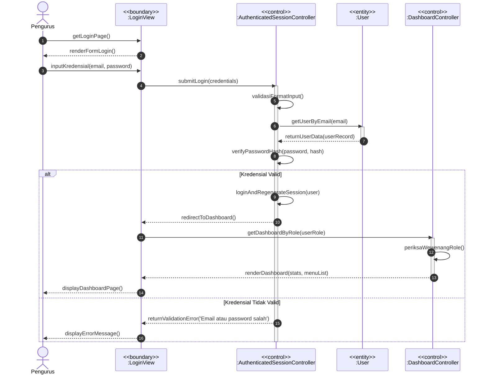
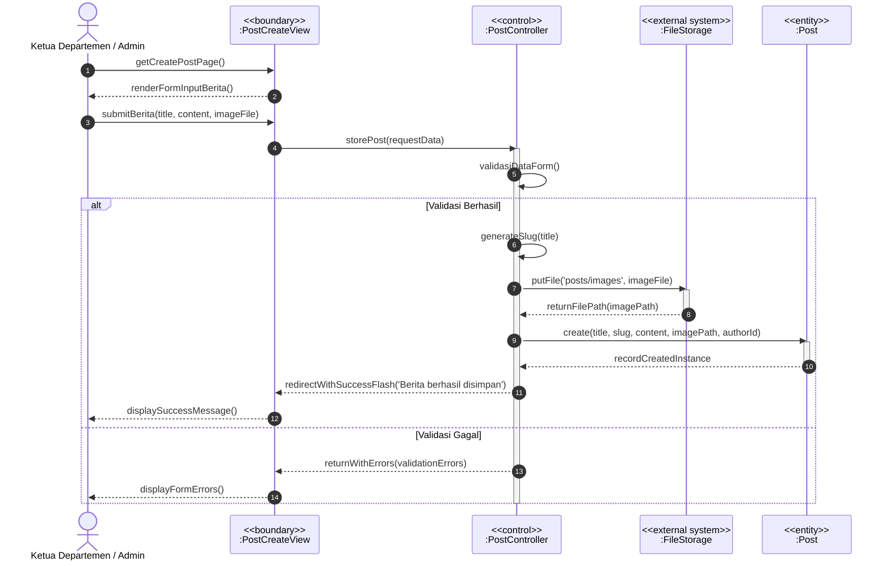
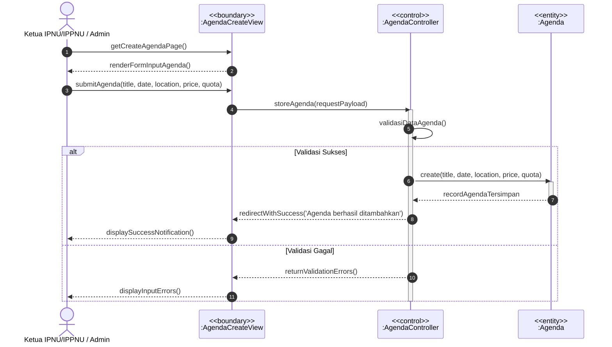
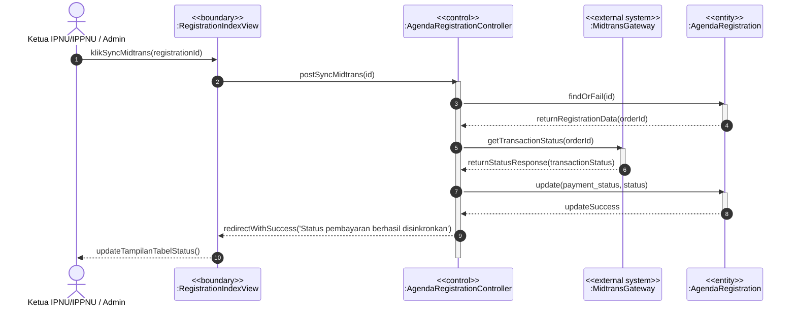
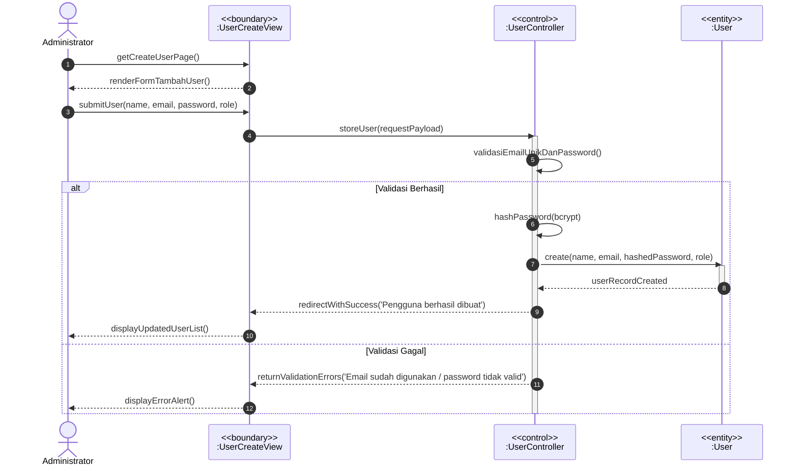

# Dokumentasi Lengkap Sequence Diagram — Sistem Informasi PK IPNU-IPPNU
*(Sesuai Standar Formal UML: Tanpa Emotikon, Notasi Boundary-Control-Entity)*

Dokumen ini memuat **6 Sequence Diagram lengkap** yang merepresentasikan interaksi objek pada use case utama aplikasi. Komponen diklasifikasikan menggunakan stereotipe arsitektur UML standar:
- **Aktor**: Pengguna manusia (`Pengunjung`, `Pengurus`, `Administrator`)
- **Boundary (`<<boundary>>`)**: Komponen antarmuka pengguna / UI View
- **Control (`<<control>>`)**: Komponen pengendali logika bisnis / Controller
- **Entity (`<<entity>>`)**: Komponen entitas data / Model Database
- **External System (`<<external system>>`)**: Layanan eksternal (*Midtrans Payment Gateway / File Storage*)

---

## 1. Sequence Diagram: Pendaftaran & Pembayaran Kegiatan (Publik & Midtrans)

---

## 2. Sequence Diagram: Autentikasi / Login Pengurus

---

## 3. Sequence Diagram: Pengelolaan Konten (Tambah Berita / Artikel)

---

## 4. Sequence Diagram: Pengelolaan Agenda Kegiatan

---

## 5. Sequence Diagram: Sinkronisasi Status Pembayaran Midtrans Manual

---

## 6. Sequence Diagram: Manajemen Pengguna / Users (Admin Only)

