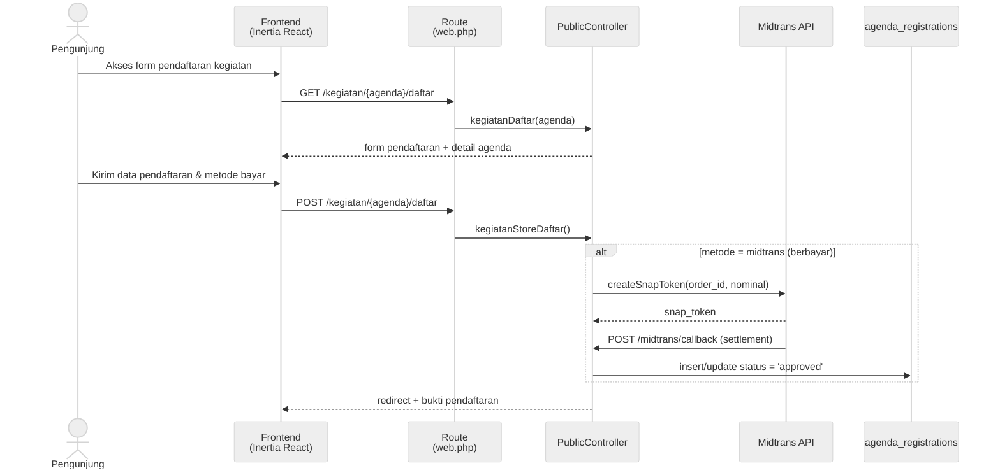
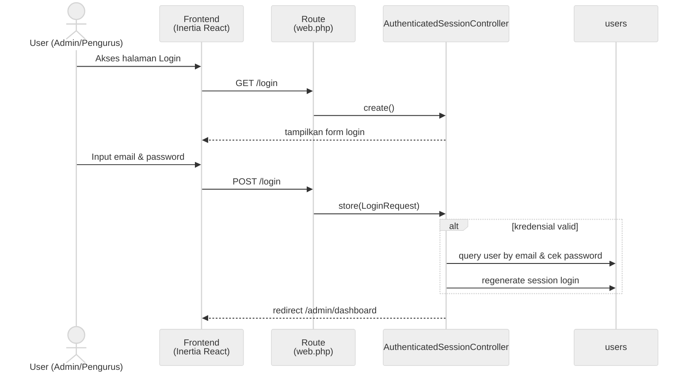
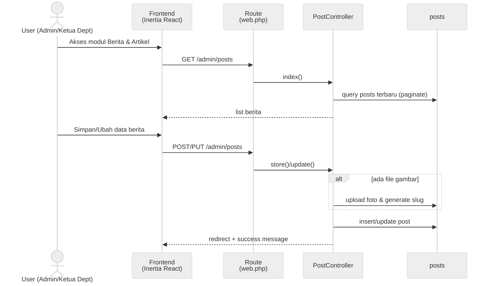
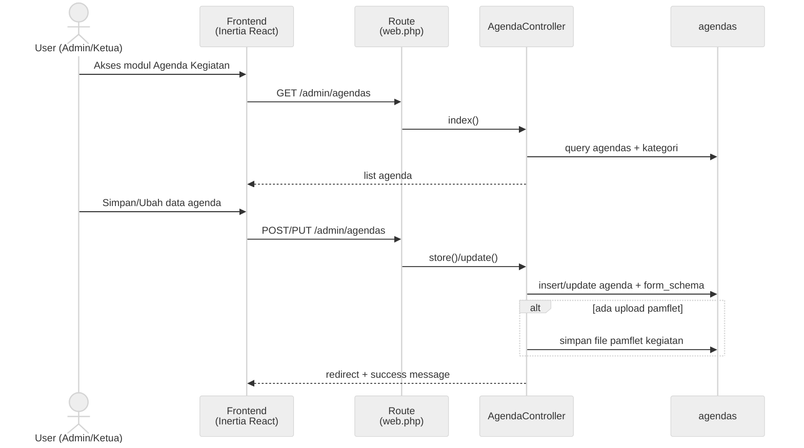
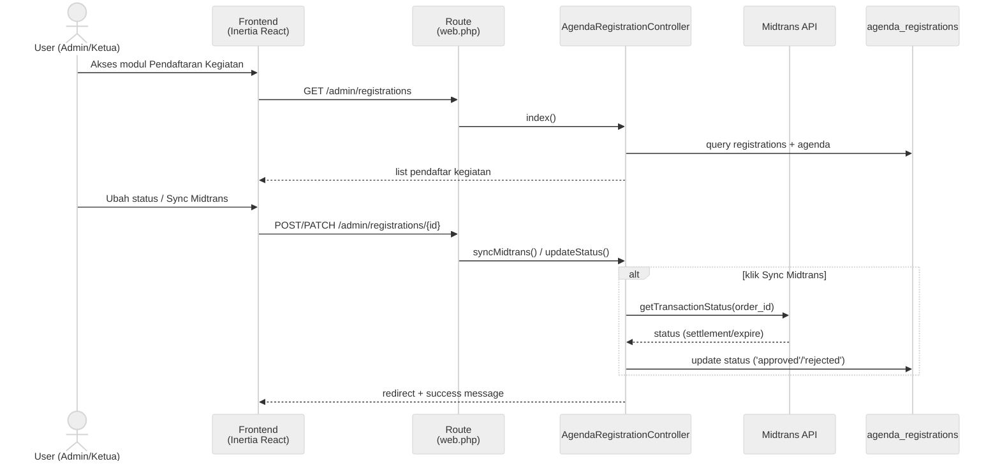
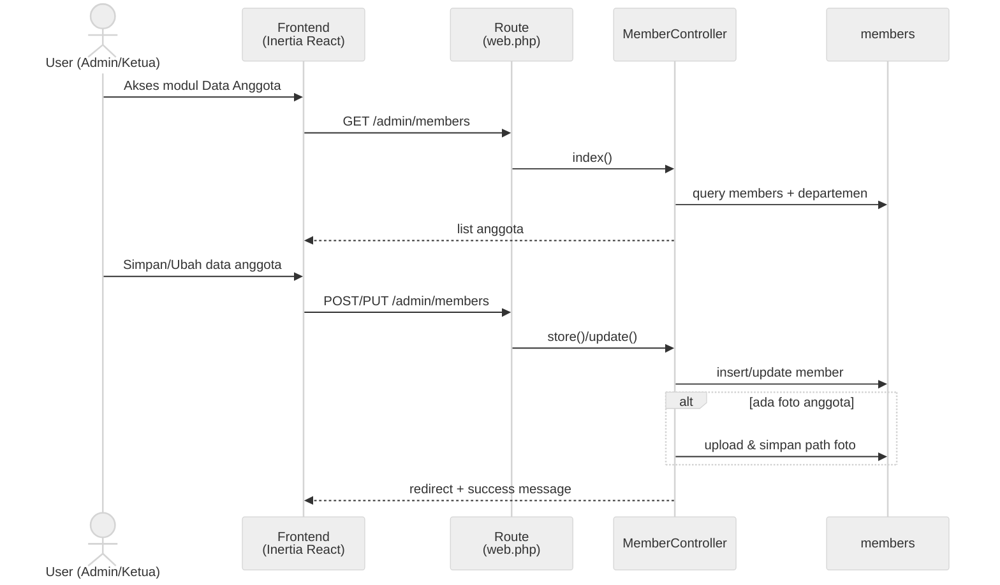
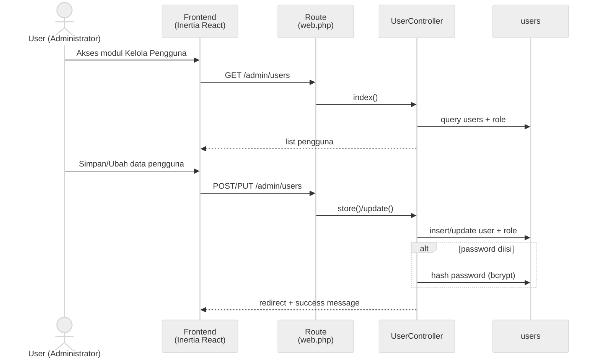

# Dokumentasi Lengkap Sequence Diagram — Sistem Informasi PK IPNU-IPPNU
*(Format Hitam Putih: Actor Stickman – Frontend (Inertia React) – Route (web.php) – Controller – Tabel Database)*

Dokumen ini memuat **7 Sequence Diagram lengkap** dengan tampilan **Hitam Putih (Monochrome)** yang merepresentasikan alur interaksi sistem sesuai gambar referensi:
- **Actor (Stickman)**: Pengguna aplikasi (`Pengunjung`, `User (Admin/Pengurus)`, `User (Admin/Ketua Dept)`, `User (Admin/Ketua)`, `User (Administrator)`)
- **Frontend (`Frontend (Inertia React)`)**: Antarmuka pengguna berbasis React & Inertia.js
- **Route (`Route (web.php)`)**: Pengarah rute HTTP Laravel (`GET`, `POST`, `PUT`, `PATCH`, `DELETE`)
- **Controller (`...Controller`)**: Pengendali logika bisnis di `app/Http/Controllers`
- **Database Table (Cylinder)**: Tabel basis data MySQL (`agenda_registrations`, `users`, `posts`, `agendas`, `members`) serta layanan eksternal (`Midtrans API`)

---

## 1. Sequence Diagram - 1) Pendaftaran & Pembayaran Kegiatan (Midtrans)

---

## 2. Sequence Diagram - 2) Autentikasi & Login Pengurus

---

## 3. Sequence Diagram - 3) Kelola Berita & Artikel (CRUD + Foto)

---

## 4. Sequence Diagram - 4) Kelola Agenda Kegiatan (CRUD + Form Schema)

---

## 5. Sequence Diagram - 5) Verifikasi Pendaftar & Sinkronisasi Midtrans

---

## 6. Sequence Diagram - 6) Kelola Data Anggota (CRUD + Foto)

---

## 7. Sequence Diagram - 7) Kelola Pengguna / User (CRUD + Role)

