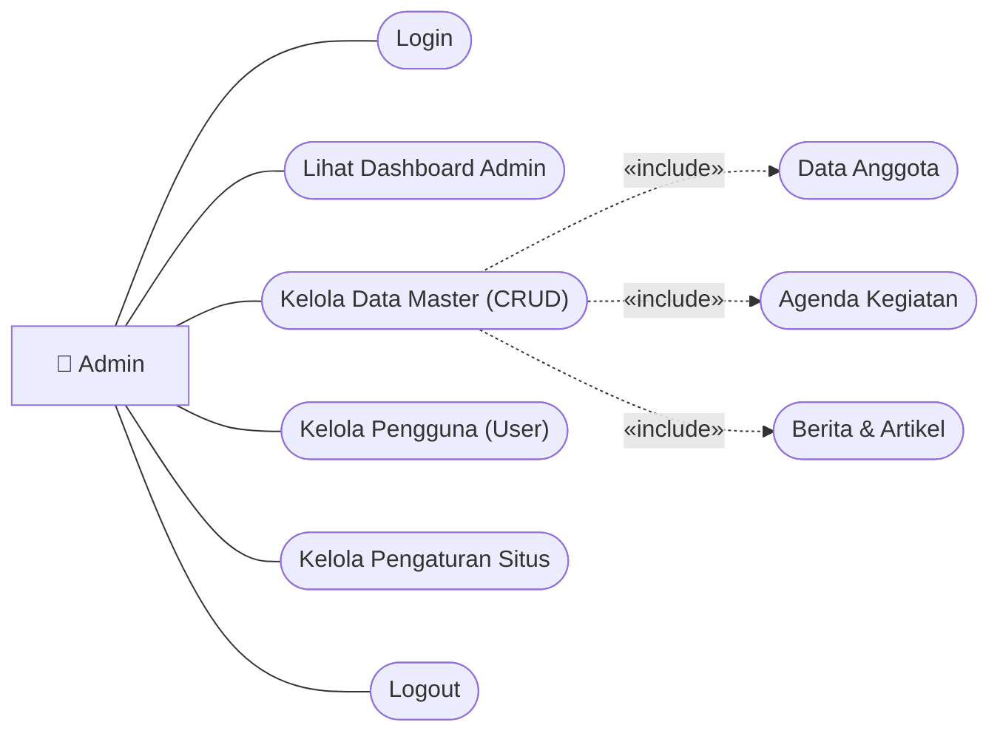
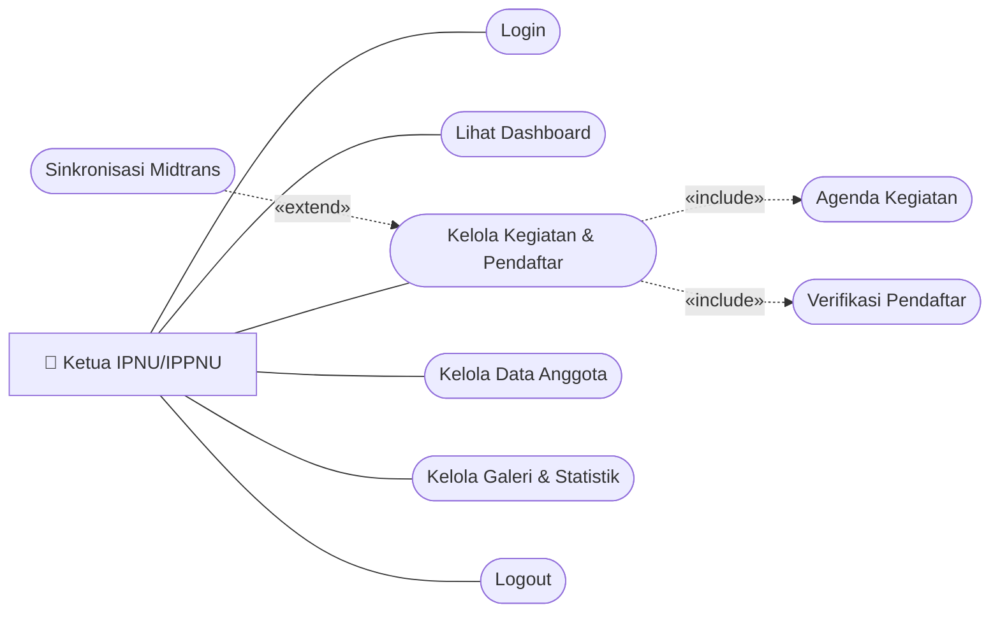
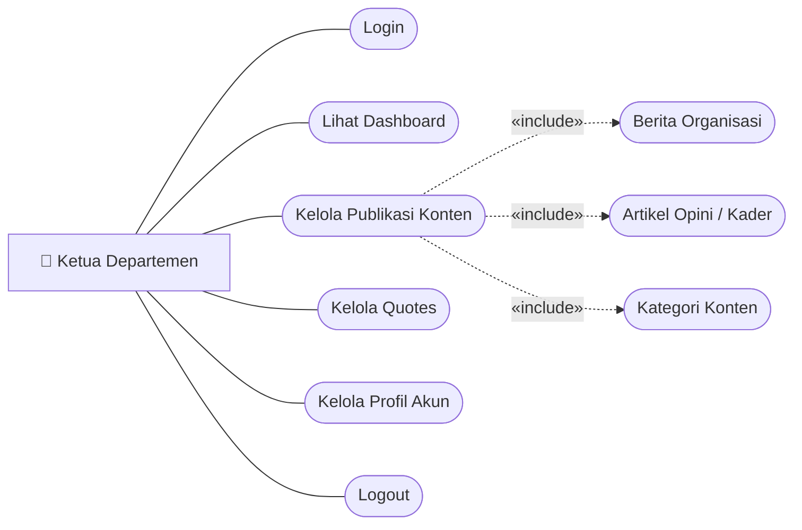
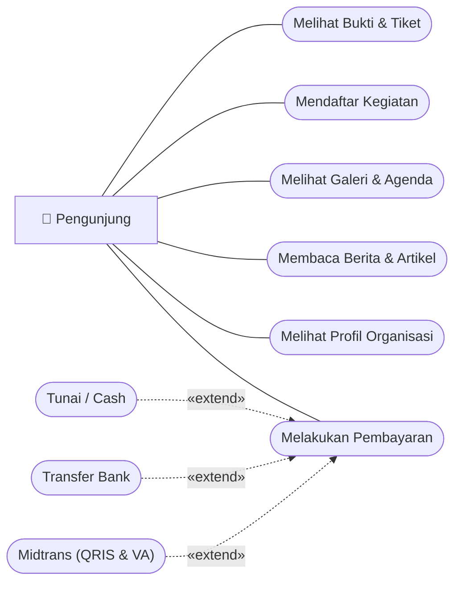

# 4.4. Use Case Diagram

Use Case Diagram menggambarkan interaksi fungsional antara pengguna luar (*aktor*) dengan sistem perangkat lunak yang dibangun. Diagram ini menjelaskan "apa" yang dapat dilakukan oleh sistem berdasarkan hak akses masing-masing aktor, yakni **Admin**, **Ketua IPNU/IPPNU**, **Ketua Departemen**, dan **Pengunjung**.

Setiap diagram per-aktor disusun dengan pola standar laporan/skripsi:
- **Aktor Primer** di sisi kiri terhubung dengan garis asosiasi lurus ke **6 Use Case Utama** secara vertikal.
- **Sub-Use Case Fungsional** berada di sisi kanan yang dihubungkan dengan relasi `<<include>>` (keharusan) atau `<<extend>>` (pilihan/kondisional).
- **Tampilan Bersih**: Dibuat hitam-putih tanpa kotak pembatas (*no boundary box*) dengan penomoran gambar resmi bab 4.

> 💡 **File Siap Ekspor di draw.io**:
> File mentahan [**`use_case_diagram.drawio`**](file:///e:/zallzall/pk-ipnu-ippnu/use_case_diagram.drawio) sudah 100% disesuaikan dengan contoh di atas. Anda dapat membukanya di **[app.diagrams.net](https://app.diagrams.net/)** lalu mengekspornya langsung ke Word/PDF.

---

## 4.4.1. Use Case Admin

Aktor Admin memiliki hak akses tertinggi (*Super User*) di dalam sistem. Admin bertanggung jawab mengelola seluruh data master organisasi, akun pengguna pengurus, dan pengaturan konfigurasi website.

<strong>Gambar 4.1 Use Case Admin</strong>

 

### Deskripsi Hak Akses Admin:
Aktor Admin memiliki wewenang penuh dalam memelihara keberlangsungan sistem:
1. **Login & Logout**: Mengamankan otentikasi akun dengan kata sandi terenkripsi.
2. **Lihat Dashboard Admin**: Memantau statistik ringkasan total kader/anggota, pendaftar aktif, berita, dan kegiatan.
3. **Kelola Data Master**: Menambah, mengubah, dan menghapus data utama yang mencakup *Data Anggota*, *Agenda Kegiatan*, serta *Berita & Artikel*.
4. **Kelola Pengguna**: Menetapkan hak akses peran (*role assignment*) untuk akun Ketua dan Ketua Departemen.
5. **Kelola Pengaturan Situs**: Mengonfigurasi identitas organisasi, logo, kontak resmi, dan tautan media sosial.

---

## 4.4.2. Use Case Ketua IPNU / IPPNU

Aktor Ketua IPNU/IPPNU memegang wewenang manajerial organisasi tingkat pimpinan: memantau program kerja kegiatan, memvalidasi pendaftar kegiatan, melakukan sinkronisasi pembayaran online, dan mengelola database kader/anggota.

<strong>Gambar 4.2 Use Case Ketua IPNU/IPPNU</strong>

 

### Deskripsi Hak Akses Ketua IPNU/IPPNU:
1. **Kelola Kegiatan & Pendaftar**: Membuat jadwal agenda dan memantau calon peserta yang mendaftar.
2. **Verifikasi Pendaftar**: Menyetujui (*approve*) atau menolak (*reject*) formulir pendaftar kegiatan.
3. **Sinkronisasi Midtrans**: Fungsi `<<extend>>` untuk memeriksa status pembayaran otomatis secara *real-time* dari server payment gateway Midtrans.
4. **Kelola Data Anggota & Statistik**: Menyimpan direktori kepengurusan dan rekapitulasi jumlah kader aktif.

---

## 4.4.3. Use Case Ketua Departemen

Aktor Ketua Departemen bertanggung jawab atas publikasi media, literasi, artikel opini kader, dan kutipan motivasi (*quotes*) organisasi.

<strong>Gambar 4.3 Use Case Ketua Departemen</strong>

 

### Deskripsi Hak Akses Ketua Departemen:
1. **Kelola Publikasi Konten**: Menulis dan mempublikasikan siaran berita resmi dan artikel kader ke website.
2. **Kelola Quotes**: Memperbarui kutipan kalam ulama dan motivasi perjuangan yang tampil di beranda website.
3. **Kelola Profil Akun**: Mengubah data profil dan kata sandi mandiri.

---

## 4.4.4. Use Case Pengunjung

Aktor Pengunjung merupakan pihak luar (masyarakat, siswa, calon kader) yang mengakses informasi organisasi secara bebas, mendaftar kegiatan, dan menyelesaikan transaksi pembayaran tiket.

<strong>Gambar 4.4 Use Case Pengunjung</strong>

 

### Deskripsi Hak Akses Pengunjung:
1. **Melihat Informasi Publik**: Mengakses sejarah, visi misi, struktur kepengurusan, berita, artikel, dan galeri kegiatan.
2. **Mendaftar Kegiatan**: Mengisi data diri pada form kegiatan yang sedang membuka pendaftaran.
3. **Melakukan Pembayaran**: Jika agenda berbayar, pengunjung dapat memilih opsi pembayaran (*extend*) via Tunai, Transfer Bank, atau otomatis lewat Midtrans (QRIS dan Virtual Account).
4. **Melihat Bukti & Tiket**: Mengunduh atau menampilkan kode registrasi sebagai tanda bukti sah pendaftaran.
