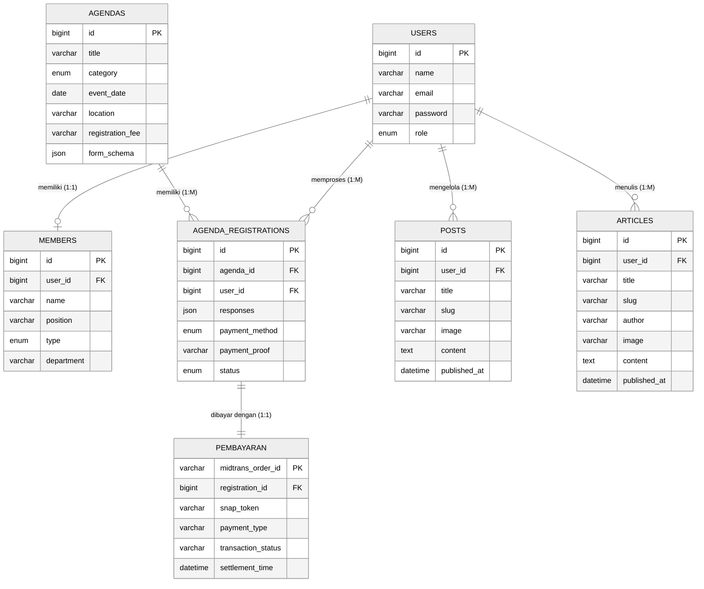

# 4.8. Entity Relationship Diagram

**Entity Relationship Diagram (ERD)** memodelkan struktur data dan hubungan antar-entitas basis data pada **Sistem Informasi PK IPNU-IPPNU** menggunakan **Notasi Chen** (*Persegi Panjang* untuk Entitas, *Elips/Oval* untuk Atribut dengan penanda `PK` dan `FK`, serta *Belah Ketupat* untuk Relasi beserta derajat kardinalitas `1` ke `1` maupun `1` ke `M`).

> 💡 **File Siap Ekspor di draw.io**:
> File mentahan [**`erd_diagram.drawio`**](file:///e:/zallzall/pk-ipnu-ippnu/laporan/diagram/erd_diagram.drawio) sudah disusun **100% mengikuti format gambar referensi Anda (`Gambar 4. 23 Entity Relationship Diagram`)**:
> - Menggunakan **Notasi Chen Hitam-Putih** (Kotak Entitas, Belah Ketupat Relasi, dan Kipas Oval Atribut yang terhubung ke satu titik tumpu pada tiap sisi entitas).
> - Penulisan *Primary Key* dan *Foreign Key* di dalam oval atribut menggunakan sufiks **`PK`** dan **`FK`** (contoh: `id PK`, `agenda_id FK`, `user_id FK`, `midtrans_order_id PK`).
> - Dilengkapi judul **`4.8. Entity Relationship Diagram`** di bagian atas dan keterangan **`Gambar 4. 23 Entity Relationship Diagram`** di bagian bawah.

---

## 4.8.1. Visualisasi Entity Relationship Diagram (Mermaid)

<strong>Gambar 4.23 Entity Relationship Diagram Sistem Informasi PK IPNU-IPPNU</strong>

---

## 4.8.2. Daftar Entitas, Atribut, dan Relasi

| No | Nama Entitas | Atribut Utama (`PK` / `FK`) | Relasi (Belah Ketupat) | Kardinalitas |
| :-: | :--- | :--- | :--- | :-: |
| 1 | **`Pembayaran`** | `midtrans_order_id PK`, `registration_id FK`, `snap_token`, `payment_type`, `transaction_status`, `settlement_time` | `dibayar dengan` (ke `AgendaRegistrations`) | `1 : 1` |
| 2 | **`AgendaRegistrations`** | `id PK`, `agenda_id FK`, `user_id FK`, `responses`, `payment_method`, `payment_proof`, `status` | `memiliki` (dari `Agendas`), `memproses` (dari `Users`), `dibayar dengan` (ke `Pembayaran`) | `M : 1` & `1 : 1` |
| 3 | **`Agendas`** | `id PK`, `title`, `category`, `event_date`, `location`, `registration_fee`, `form_schema` | `memiliki` (ke `AgendaRegistrations`) | `1 : M` |
| 4 | **`Users`** | `id PK`, `name`, `email`, `password`, `role` | `memproses` (`AgendaRegistrations`), `memiliki` (`Members`), `mengelola` (`Posts`), `menulis` (`Articles`) | `1 : M` & `1 : 1` |
| 5 | **`Members`** | `id PK`, `user_id FK`, `name`, `position`, `type`, `department` | `memiliki` (dari `Users`) | `1 : 1` |
| 6 | **`Posts`** | `id PK`, `user_id FK`, `title`, `slug`, `image`, `content`, `published_at` | `mengelola` (dari `Users`) | `M : 1` |
| 7 | **`Articles`** | `id PK`, `user_id FK`, `title`, `slug`, `author`, `image`, `content`, `published_at` | `menulis` (dari `Users`) | `M : 1` |

